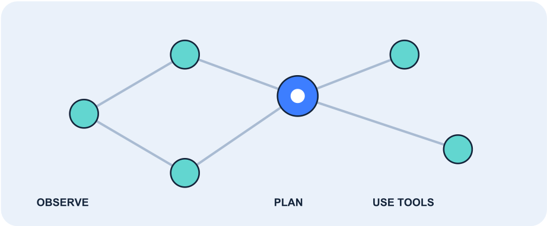
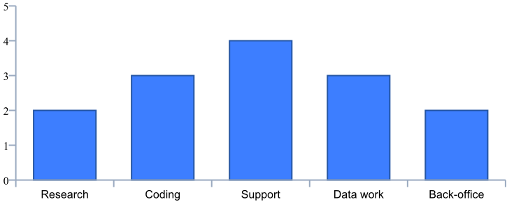

## AI Agents in 2026

From chat assistants to systems that plan, use tools and complete multi-step work

## Why this topic matters

The recent shift in artificial intelligence is not only about models producing better text or images. It is also about agentic systems: applications that can break a goal into steps, call tools, inspect results and continue until a task is complete. In practical terms, an agent might search documentation, run code, summarize findings and prepare a report-with a person setting boundaries and reviewing important decisions.

Core idea: a chatbot primarily responds to a prompt; an agentic workflow can take a sequence of actions toward an objective. The distinction is a spectrum, not a strict technical category.

## A simple agent loop

1. Observe the request and available context. 2. Plan a next step. 3. Use a tool or take an action. 4. Check the result. 5. Repeat or stop when the goal is met.

## Where agents are being applied

Common areas of experimentation include software engineering, customer support, research, data analysis and business-process automation. The strongest early use cases tend to have a clear goal, accessible tools, measurable outcomes and a human escalation path.

## A conceptual workflow

A coding assistant, for example, may inspect a repository, identify relevant files, propose a change, run tests and summarize what changed. Each tool call creates a point where permissions, logging and validation matter.

| 1. Understand Goal + constraints   | 2. Plan Break into steps   | 3. Act Call tools   | 4. Verify Check outputs   | 5. Report Human review   |
|------------------------------------|----------------------------|---------------------|---------------------------|--------------------------|

## What the chart says-and does not say

Illustrative discussion scores only (1-5), not measured adoption, market share or a published survey. They are included to provide a chart for PDF-parsing practice.

## A practical evaluation checklist

- Reliability: Does it complete the task consistently, including edge cases?
- Tool safety: Are permissions limited and destructive actions confirmed?
- Observability: Can you inspect prompts, tool inputs/outputs, errors and latency?
- Human oversight: Is there a clear review or escalation point?
- Cost and speed: Is the full workflow better than a simpler script or chain?

## Risks, guardrails and what to watch

Agents introduce risks beyond ordinary text generation because they can interact with external systems. A mistaken answer may be inconvenient; a mistaken action can change a record, send a message or modify a codebase. Design the workflow so that the model has only the permissions it needs.

## Recommended guardrails

- Give tools narrow, task-specific permissions.
- Require confirmation before payments, deletion, publishing or other consequential actions.
- Validate tool arguments and outputs rather than trusting generated content.
- Keep audit logs of decisions, tool calls, failures and approvals.
- Add limits for steps, runtime, retries and spending.
- Test against prompt injection and untrusted content from retrieved pages or files.

## A sensible adoption path

Start with one bounded workflow where success can be checked automatically. Compare the agent against a deterministic baseline. Add autonomy only when the system demonstrates reliable performance, and retain a human approval step for high-impact actions.

## Takeaway

In 2026, agentic AI is an important design pattern to understand-but autonomy is not automatically an advantage. The useful question is not "Can an agent do this?" but "Can it do this reliably, safely and measurably better than a simpler workflow?"

## Reading note

This short learning brief is designed as a sample document for testing PDF ingestion with Docling. The illustration and chart are original, and the chart values are intentionally synthetic rather than current industry statistics. For a research report, replace them with dated, attributable measurements.